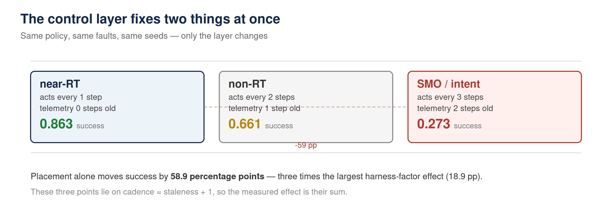
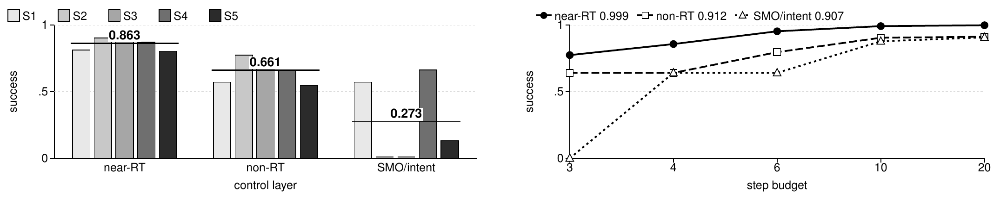

# Where Should the Agent Live?

**English** · [简体中文](README.zh-CN.md)

Reproduction artifact for the paper:

> **Where Should the Agent Live? A Controller-Fixed Factorial Study of
> Control-Layer Placement for Network Operations Agents**
> AIxNET 2026 — Poster and Demo Session, Paris, 23–25 November 2026.

The study holds the task, the harness configuration and the controller fixed and
varies **only the control layer** at which an agent executes, defined purely by
**decision cadence** and **telemetry staleness**.



---

## Requirements

**Python 3 standard library only.** No network, no API key, no GPU, no container,
no third-party packages.

```bash
python3 --version    # 3.10 or newer
```

The language-model arms in the shipped CSVs were produced with a local
OpenAI-compatible server; **re-running those arms** requires such a server, but
**nothing in this artifact needs one** — the CSVs are included.

---

## One command

```bash
python3 run_demo.py demo-live
```

Recomputes the study's factorial live (~9 s on a laptop), prints the layer
table, then prints the shipped language-model table. Every printed number is
either recomputed now or read from a shipped CSV.



*Left: success per scenario at each layer, with the pooled means. Right: the
step-budget sweep — once the budget stops binding, the three layers converge.*

---

## What it reproduces

| Step | Command | What it does |
|---|---|---|
| Self-check | `python3 run_demo.py selfcheck` | Full test suite (25 groups) |
| Live demo | `python3 run_demo.py demo-live` | Recomputes the 14,400-episode factorial (~9 s) |
| One episode | `python3 run_demo.py demo` | Narrated single episode, ~0.04 s |
| Full sweep | `python3 run_demo.py sweep --reps 20` | Regenerates `out/episodes.csv` |
| Trace replay | `python3 run_demo.py replay <trace.jsonl>` | Deterministic replay of one episode |
| Replay all | `python3 run_demo.py replay-all --dir out/traces` | 1,005 / 1,005 exact |
| Simulator validation | `python3 validate.py` | Known-answer, mechanism, invariance, physics, cross-implementation checks |
| Number trace | `python3 verify_numbers.py` | Every headline number traced to a CSV row |

---

## Headline result

| Layer | Acts | Telemetry | Success |
|---|---|---:|---:|
| `near_rt` — xApp in the near-RT RIC | every 1 step | current | **0.863** |
| `non_rt` — rApp in the non-RT RIC | every 2 steps | 1 step old | 0.661 |
| `smo_intent` — SMO / intent layer | every 3 steps | 2 steps old | 0.273 |

Same policy, same faults, same seeds. **Placement alone moves success from 0.863
to 0.273** — 58.9 percentage points, more than three times the largest
harness-factor effect (18.9 pp) on the same episodes.

A negative result is reported alongside: once the step budget stops binding, the
harness factor's advantage collapses while the placement effect survives.

---

## Design of the three layers

| Layer | Cadence | Staleness | O-RAN correspondence |
|---|---:|---:|---|
| near_rt | 1 step | 0 steps | near-RT RIC (xApp), 10 ms–1 s loop |
| non_rt | 2 steps | 1 step | non-RT RIC (rApp), policy timescale |
| smo_intent | 3 steps | 2 steps | SMO / intent layer |

These three points lie on the line `cadence = staleness + 1`, so the measured
layer effect is the sum of the two properties. Separating them requires a full
3 × 3 grid, which is the subject of a companion study.

---

## Data manifest

The shipped CSVs are the manifest. Columns are self-describing; every row
carries the layer, the seed, the scenario and the harness configuration.

| File | Episodes | What it is |
|---|---:|---|
| `out/episodes.csv` | 14,400 | Deterministic controller, 48 harness configs × 3 layers × 5 faults × 20 seeds |
| `out/budget_sensitivity.csv` | 36,000 | Step-budget sweep |
| `out/focused.csv` | 5,000 | Pre-registered contrast set |
| `out/llm_arm_scoped3.csv` | 150 | qwen3.8:27B at the near-RT layer |
| `out/llm_layer_qwen2-5-7b_scoped3_*.csv` | 450 | qwen2.5:7B at all three layers |
| `out/llm_layer_qwen2-5-14b_scoped3_*.csv` | 450 | qwen2.5:14B at all three layers |
| `out/llm_layer_qwen3-8-27b-q4-K-M_scoped3_*.csv` | 300 | qwen3.8:27B at non-RT and SMO/intent |
| `out/decoupled_grid.csv` | 43,200 | The full 3 × 3 decoupled grid over (cadence, staleness); n = 4,800 per cell |
| `out/crossdomain_grid.csv` | 103,680 | Cross-domain grid: `domain` selects packet (43,200) or queue (60,480) |
| `out/water_episodes.csv` | 14,400 | Second physical domain: water distribution network |
| `out/random_faults_episodes.csv` | 4,320 | Packet domain under randomly sampled faults |
| `out/water_random_faults_episodes.csv` | 86,400 | Water domain under randomly sampled faults |
| `out/guardrail_frontier_episodes.csv` | 50,400 | Seven-level guardrail strictness ladder |
| `out/nlayer_budget_episodes.csv` | 100,800 | One-to-seven layer deployment across step budgets |

The language-model arm totals **1,350 episodes**: three models, three layers,
150 per cell.

---

## Limits

This is emulator-only. The 14,400-episode factorial uses a deterministic
scripted controller, so 0.863 / 0.661 / 0.273 characterises that policy, task set
and twin, not a frontier language model. The language-model replication uses one
open-weight family at 7B, 14B and 27B, n = 150 per layer, prompt-parsed tool
calls, temperature 0, and one run per cell.

There is no real O-RAN testbed — no E2/A1 interface, RIC or radio — so "near-RT"
is a cadence-and-staleness abstraction and latency is wall-clock, not
over-the-air.

Two non-LLM baselines (a runbook and a one-step lookahead search) outperform
every agentic arm on this fault set, which is itself a reported result.

---

## License

- **Code** (`aixnet/`, `tests/`, `*.py`) — **MIT**, see [`LICENSE`](LICENSE)
- **Data** (`out/*.csv`) — **CC BY 4.0**, see [`LICENSE-DATA`](LICENSE-DATA)

If you use the data, please cite the paper above (that is the attribution
requirement of CC BY 4.0).

---

## Layout

```
aixnet/                 simulator, controllers, harness, domains
tests/                  test suite run by `selfcheck`
docs/figures/           figures used in this README
run_demo.py             single entry point for every command above
validate.py             independent simulator checks
verify_numbers.py       traces headline numbers to CSV rows
out/                    the data manifest (see table above)
```
