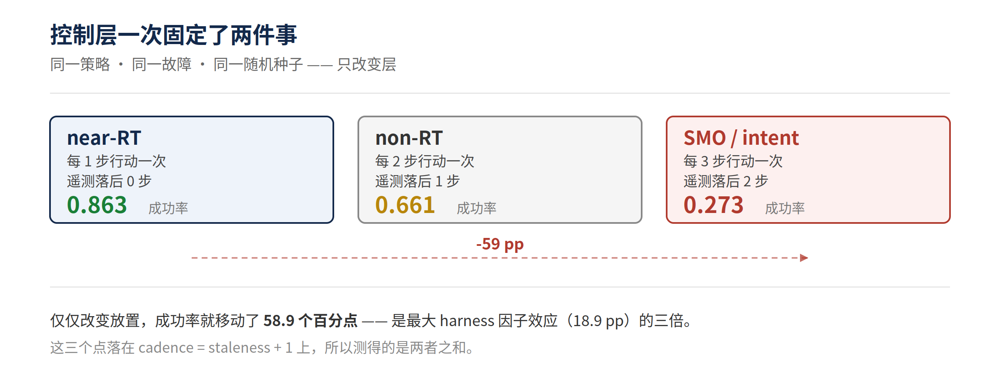
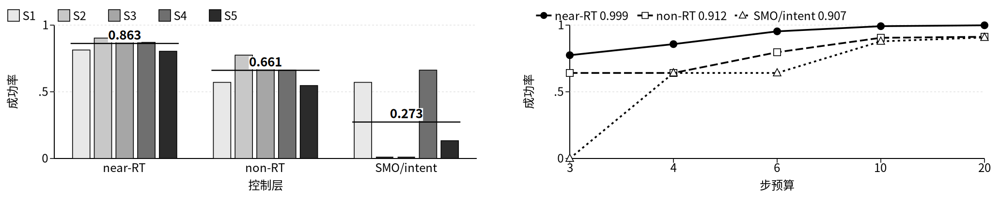

# 智能体该住在哪里？

[English](README.md) · **简体中文**

本仓库是以下论文的可复现 artifact：

> **Where Should the Agent Live? A Controller-Fixed Factorial Study of
> Control-Layer Placement for Network Operations Agents**
> （《智能体该住在哪里？一项控制器固定的、关于网络运维智能体控制层放置的析因研究》）
> AIxNET 2026 — 海报与演示会场，巴黎，2026 年 11 月 23–25 日

研究固定任务、harness 配置与控制器，**只改变智能体执行所在的控制层**，
而「层」纯粹由**决策节奏**（decision cadence）与**遥测陈旧度**（telemetry staleness）定义。



---

## 环境要求

**只用 Python 3 标准库。** 不需要网络、API key、GPU、容器，也不需要任何第三方包。

```bash
python3 --version    # 3.10 或更新
```

仓库里的语言模型结果（CSV）是用本地 OpenAI 兼容服务跑出来的；
**重跑那部分**需要这样一个服务，但**本 artifact 的任何命令都不需要** —— CSV 已经附上。

---

## 一条命令

```bash
python3 run_demo.py demo-live
```

现场重算整项析因实验（笔记本上约 9 秒），打印层表，再打印已发布的语言模型表。
每一个打印出来的数字，要么是当场重算的，要么读自随附的 CSV。



*左：每层的各场景成功率与合并均值。右：步预算扫描 —— 预算不再成为约束时，三层收敛。*

---

## 能复现什么

| 步骤 | 命令 | 作用 |
|---|---|---|
| 自检 | `python3 run_demo.py selfcheck` | 完整测试套件（25 组）|
| 现场演示 | `python3 run_demo.py demo-live` | 重算 14,400 回合析因实验（约 9 秒）|
| 单个回合 | `python3 run_demo.py demo` | 带解说的单回合，约 0.04 秒 |
| 完整扫描 | `python3 run_demo.py sweep --reps 20` | 重新生成 `out/episodes.csv` |
| 轨迹重放 | `python3 run_demo.py replay <trace.jsonl>` | 单回合确定性重放 |
| 全部重放 | `python3 run_demo.py replay-all --dir out/traces` | 1,005 / 1,005 精确一致 |
| 模拟器验证 | `python3 validate.py` | 已知答案、机制、不变性、物理、交叉实现等断言 |
| 数字溯源 | `python3 verify_numbers.py` | 每个标题数字都追溯到 CSV 的某一行 |

---

## 核心结果

| 层 | 行动频率 | 遥测 | 成功率 |
|---|---|---:|---:|
| `near_rt` —— 近实时 RIC 里的 xApp | 每 1 步 | 当前 | **0.863** |
| `non_rt` —— 非实时 RIC 里的 rApp | 每 2 步 | 旧 1 步 | 0.661 |
| `smo_intent` —— SMO / 意图层 | 每 3 步 | 旧 2 步 | 0.273 |

**同一策略、同一故障、同一随机种子。仅仅改变放置，成功率从 0.863 掉到 0.273** ——
58.9 个百分点，是同一批回合上最大 harness 因子效应（18.9 pp）的三倍以上。

论文同时报告了一个负结果：一旦步预算不再成为约束，harness 因子的优势就崩塌，
而放置效应仍然存活。

---

## 三层的设计

| 层 | 节奏 | 陈旧度 | 对应的 O-RAN 位置 |
|---|---:|---:|---|
| near_rt | 1 步 | 0 步 | 近实时 RIC（xApp），10 ms–1 s 环 |
| non_rt | 2 步 | 1 步 | 非实时 RIC（rApp），策略时间尺度 |
| smo_intent | 3 步 | 2 步 | SMO / 意图层 |

这三个点落在直线 `cadence = staleness + 1` 上，**所以测得的层效应是这两个属性之和**。
要把它们分开，需要一个完整的 3 × 3 网格 —— 那是另一篇配套论文的主题。

---

## 数据清单

随附的 CSV 就是清单。列名自解释；每一行都带层、种子、场景与 harness 配置。

| 文件 | 回合数 | 内容 |
|---|---:|---|
| `out/episodes.csv` | 14,400 | 确定性控制器，48 个 harness 配置 × 3 层 × 5 种故障 × 20 个种子 |
| `out/budget_sensitivity.csv` | 36,000 | 步预算扫描 |
| `out/focused.csv` | 5,000 | 预注册的对比集合 |
| `out/llm_arm_scoped3.csv` | 150 | qwen3.8:27B 在近实时层 |
| `out/llm_layer_qwen2-5-7b_scoped3_*.csv` | 450 | qwen2.5:7B 在全部三层 |
| `out/llm_layer_qwen2-5-14b_scoped3_*.csv` | 450 | qwen2.5:14B 在全部三层 |
| `out/llm_layer_qwen3-8-27b-q4-K-M_scoped3_*.csv` | 300 | qwen3.8:27B 在非实时与 SMO/意图层 |
| `out/decoupled_grid.csv` | 43,200 | 完整的 3 × 3 解耦网格（按节奏 × 陈旧度）；每格 n = 4,800 |
| `out/crossdomain_grid.csv` | 103,680 | 跨域网格：`domain` 列区分 packet（43,200）与 queue（60,480）|
| `out/water_episodes.csv` | 14,400 | 第二个物理域：配水网络 |
| `out/random_faults_episodes.csv` | 4,320 | packet 域，随机采样故障 |
| `out/water_random_faults_episodes.csv` | 86,400 | water 域，随机采样故障 |
| `out/guardrail_frontier_episodes.csv` | 50,400 | 七级护栏严格度阶梯 |
| `out/nlayer_budget_episodes.csv` | 100,800 | 一层到七层部署，跨多个步预算 |

语言模型部分共 **1,350 回合**：三个模型、三个层、每格 150 回合。

---

## 局限

**这是纯模拟器研究。** 14,400 回合的析因实验用的是确定性脚本控制器，
所以 0.863 / 0.661 / 0.273 刻画的是那个策略、任务集与数字孪生，**不是前沿语言模型**。
语言模型复现只用了一个开源权重模型家族（7B、14B、27B），每层 n = 150，
工具调用是提示词解析（不是原生 tools API），温度 0，每格只跑一次。

**没有真实的 O-RAN 试验床** —— 没有 E2/A1 接口、没有 RIC、没有射频 ——
所以「近实时」是一个节奏与陈旧度的抽象，延迟是墙钟时间，不是空口时间。

两个非 LLM 基线（一个 runbook、一个一步前瞻搜索）在这套故障集上**打赢了所有智能体配置** ——
**这本身就是一个被报告的结果，不是被藏起来的**。

---

## 许可

- **代码**（`aixnet/`、`tests/`、`*.py`）—— **MIT**，见 [`LICENSE`](LICENSE)
- **数据**（`out/*.csv`）—— **CC BY 4.0**，见 [`LICENSE-DATA`](LICENSE-DATA)

使用数据请引用上面的论文（这是 CC BY 4.0 的署名要求）。

---

## 目录结构

```
aixnet/                 模拟器、控制器、harness、各物理域
tests/                  `selfcheck` 跑的测试套件
docs/figures/           本 README 用到的图
run_demo.py             上面所有命令的统一入口
validate.py             独立的模拟器校验
verify_numbers.py       把标题数字追溯到 CSV 行
out/                    数据清单（见上表）
```
